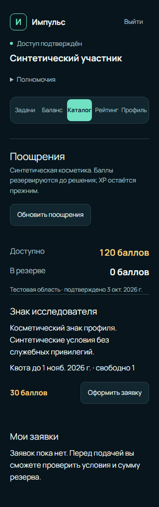
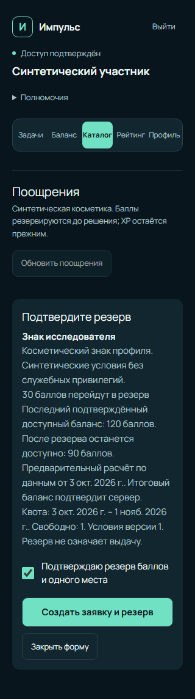
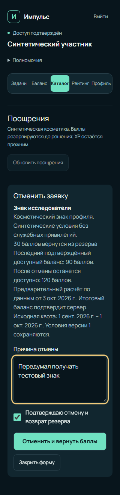

# F06: независимая проверка интерфейса

Дата: 03.10.2026. Объект — локальное расширение рабочего приложения, `apps/app/src/features/rewards/reward-catalog.tsx`, `rewards.css`, навигация и журнал. Направление — `apps/app/.impeccable/surfaces/apps-app-src-features-rewards-reward-catalog-tsx.md`; требования — IMPLEMENTATION_PLAN.md § 7. Incumbent DESIGN.md и `.impeccable/design.json` сохранены.

Использован finish loop установленного Impeccable: отдельный generic reviewer по `reference/degraded/finish-reviewer.md`, затем отдельный documenter по `reference/document.md` и `reference/degraded/documenter.md`. В данном harness роли выполнялись изолированными subagents. Отдельная QUALITY BAR card не предоставлялась; reviewer применил наследуемый контракт Operate и craft floor. Это визуальное ревью среза, не приёмка F06/R1.

## Именованные замечания и verdict

Первый reviewer-pass вернул `fix` с двумя материальными замечаниями:

1. На 320 px подпись «Профиль» разрывалась внутри слова. Исправлены локальные spacing и nowrap компактной навигации; все пять подписей помещаются в одну строку на 320/360/390/1280 px, целевые области остаются ≥44 px. Browser проверяет также внутренний scrollWidth каждого пункта.
2. Перед подтверждением не было предварительного остатка. Форма теперь показывает последний подтверждённый доступный баланс, его время, рассчитанный остаток и явно указывает, что итог подтвердит сервер. При синтетическом исходном балансе 120 и цене 30 видно 120 → 90; при отмене 90 → 120. Отрицательный предварительный остаток запрещает свежую подачу, сервер независимо проверяет деньги.

После новой production build и recapture reviewer выполнил verdict-pass только этих двух замечаний: оба `Resolved`, `remaining: Clear`, `disposition: ship`. Видимых регрессий от этого исправления не найдено. Ship относится к оценённым исправлениям, не всему сервису.

Documenter: `No changes`. Проверены PRODUCT.md, DESIGN.md, sidecar, § 7 плана, surface brief, runtime tokens, стили/компоненты и финальные catalog/reserve captures. Палитра navy/mint/gold, Manrope, flat rows, тональная confirmation panel и gold focus соответствуют существующей системе; новых токенов, библиотек, изображений или декоративного движения нет. Исторический абзац DESIGN о четырёх разделах описывает прежний срез; текущие пять записаны в документации этой реализации. Этот частный переход не превращён в глобальное правило, R0 sidecar не переписан.

## Артефакты

- Единственный detector-pass: `impeccable.cmd detect --json --scope layout apps/app/src/features/rewards/reward-catalog.tsx apps/app/src/features/rewards/rewards.css apps/app/src/features/tasks/task-list.tsx apps/app/src/app/globals.css` — exit 0, `[]`, сохранён в `assets/f06-reservations/layout-detector.json`. Детектор не заменяет screenshot review.
- Два builder-pass с групповой визуальной проверкой всех девяти captures; затем только reviewer-directed fixes и verdict. Финальные файлы — `assets/f06-reservations/rewards/*.png`, review packet `.impeccable/review/f06-reservations`, desktop/mobile aliases только внутри этого нового каталога.
- Provenance через установленный `embed-prompt`: 9 rasters / 0 missing. Источник — Playwright Chromium и синтетические HTTP fixtures; PNG pixels не редактировались.
- Browser: 21 сценарий, отсутствие горизонтального overflow/page errors, focus confirmation, Enter, checkbox/reason, цены/балансы, повторение неизменного запроса, stale/error/access states. Физическая клавиатура и Telegram на Android/iOS не проверялись.

